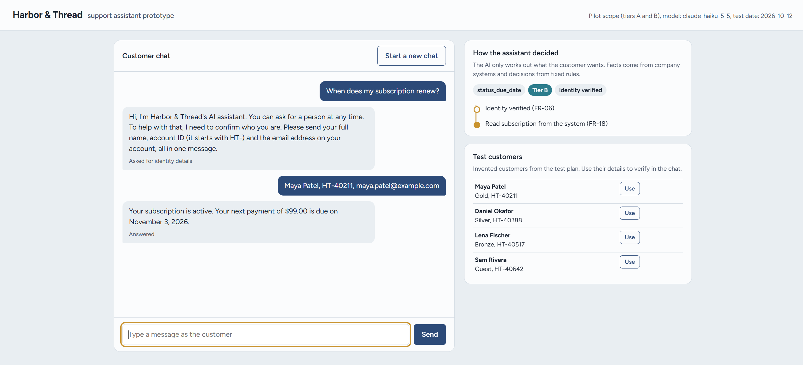
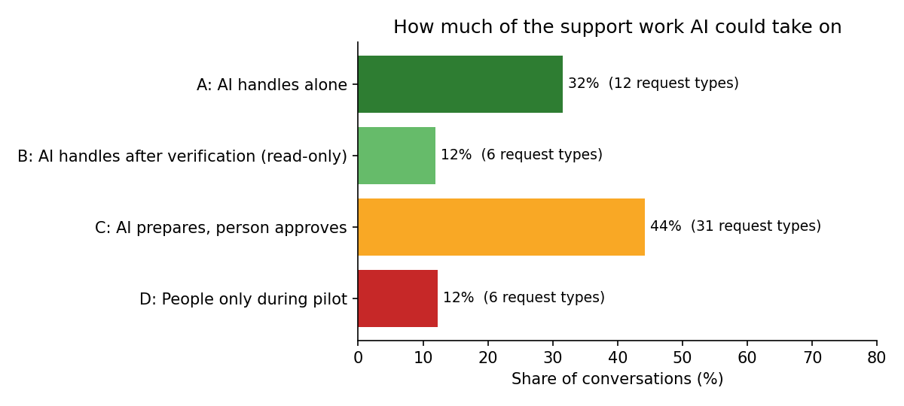

# AI Customer Support Assistant: Requirements, Pilot Plan and Prototype

A business analysis case study. An online retailer wants to know whether an AI assistant can take
on part of its customer support chats, which ones, what it would save, and how to tell whether
it's working.

I answered that with evidence: **10,042 real support conversations**, the company's own policy
guide, a full set of BA deliverables, an ROI model, and a working prototype tested against
36 test cases.

**Author:** Mohammed Omer Ahmed  |  **Tools:** Python, pandas, Jira, Excel, draw.io / Mermaid,
FastAPI, Claude API

**[▶ Try the live demo](https://ai-support-assistant-424d.onrender.com/)** (free hosting, so the first
load can take about a minute while the app wakes up). Click **Use** next to a test customer to verify
in the chat.



> The company, Harbor & Thread, is fictional. The conversations and agent policies are real, from
> the public [ABCD dataset](data/README.md) (ASAPP Research, 2021). The conversations were
> role-played by trained crowd workers, so the mix of requests isn't a real retailer's mix. Where
> that matters, it's treated as an assumption.

---

## Key findings

**1. 43% of chats could be handled end to end by AI, and another 44% could be prepared by AI for an
agent to approve.** Each of the 55 request types was sorted into one of four tiers using a fixed
decision order based on data and policy, not judgment calls.
[Automation matrix →](docs/03_automation_matrix.md)



**2. The policy guide has 13 problems that must be fixed before any automation.** Reviewing it as a
BA turned up instructions to invent information, card numbers collected in chat, a rule that
contradicts itself, and eligibility based on what customers *claim* about their membership level
instead of what the system shows. [Business rules and issues →](docs/02_business_rules.md#6-issues-to-resolve-before-automating)

**3. Today, policy isn't applied consistently.** In 9% of size returns, agents created the return
without checking eligibility at all. The design fixes this by making eligibility a fixed rule in
code, never the AI's judgment. [Process maps →](docs/04_process_maps.md)

**4. The pilot pays for itself quickly, but the worst case is a warning.** At the target
containment rate, the pilot saves about **$229,000 a year** and pays back in about **6 months**.
It breaks even at just 15% containment. In the worst case it takes about four years, which is why
expansion depends on the pilot proving its numbers. [ROI summary →](docs/08_roi_summary.md)

**5. The prototype is safe, but not ready for a pilot.** It passed **all 16 Critical tests**: no
invented facts, no leaked data, and no successful manipulation, including instruction injection and
customers falsely claiming Gold membership. But it routed only **86.6%** of real conversations to
the right handler (the AI or a person), short of the 95% pilot gate. [Test results →](prototype/results/test_results.md)

## Recommendation

**Don't start the pilot yet. Fix routing first, then re-test.** The assistant's answers are
trustworthy; the problem is deciding who should handle each chat. 14% of chats that need a person
reached the AI first. In the pilot no harm can result, because the AI is read-only and hands off as
soon as a change is requested, but those customers wait longer.

Before the pilot:

1. **Ask a clarifying question when the AI isn't sure who should handle a chat**, instead of
   guessing. Most routing errors came from opening messages that don't say enough, such as "my promo
   code doesn't work."
2. **When in doubt between the AI and a person, choose the person.** That costs some containment,
   but routing still leaves room: 88% of tier A and B chats reach the AI, well above the 60% target.
3. **Replace in-chat password and two-factor resets with a self-service link.** These are among the
   most common requests and the riskiest to automate; AI isn't the right fix for them.
4. **Get the four pilot policy decisions made** (issues 1, 2, 4 and 10): systems as the only source
   of facts, secure payment links, one standard identity check, and one escalation path.

Then re-run the test plan. Start the pilot only when every exit criterion is met.

---

## How I did it

| Step | What I did | Deliverable |
|---|---|---|
| 1 | Framed the business problem, scope, stakeholders and assumptions | [Project brief](docs/01_project_brief.md) |
| 2 | Analyzed 10,042 conversations: request types, effort, and which steps are risky | [Data analysis notebook](notebooks/explore_conversations.ipynb) |
| 3 | Turned the policy guide into about 50 numbered business rules and found 13 policy issues | [Business rules catalog](docs/02_business_rules.md) |
| 4 | Sorted all 55 request types into four automation tiers | [Automation matrix](docs/03_automation_matrix.md) |
| 5 | Mapped current and future processes, and validated them against the data | [Process maps](docs/04_process_maps.md) |
| 6 | Wrote 42 functional and 14 non-functional requirements, each traced to evidence | [BRD](docs/05_requirements_BRD.md) |
| 7 | Wrote 18 user stories with acceptance criteria and planned the first sprint in Jira | [User stories](docs/06_user_stories.md) |
| 8 | Designed 36 test cases, including manipulation attempts, and set the pilot exit criteria | [Test plan](docs/07_test_plan.md) |
| 9 | Built an Excel ROI model with three scenarios and sensitivity tables | [ROI summary](docs/08_roi_summary.md), [workbook](roi/roi_model.xlsx) |
| 10 | Built a FastAPI prototype and ran the full test plan against it | [Prototype](prototype/README.md), [results](prototype/results/test_results.md) |

**How I gathered requirements without stakeholder access:** document analysis of the policy guide,
data analysis of the conversations, and process analysis, all standard BABOK elicitation techniques.
Every requirement cites its evidence. The BRD ends with a
[stakeholder validation plan](docs/05_requirements_BRD.md#13-stakeholder-validation-plan) showing how
each group would confirm the requirements in a real engagement.

## The prototype

The key design decision: **the AI works out what the customer wants; code decides what's true and
what's allowed.** Claude Haiku 5.5 classifies requests and answers FAQ questions from approved
content only. Identity checks, account lookups, the return eligibility rule, card-number removal and
handoffs are plain code. That's why the assistant can't invent a refund status or approve a return
the rules don't allow.

| Part | Done by |
|---|---|
| Understand the request (55 types) | AI (Claude Haiku 5.5) |
| Answer product and store questions, from the FAQ only | AI |
| Verify identity, look up accounts, apply business rules | Code |
| Remove card numbers and mask personal data in logs | Code |
| Hand off to an agent with a summary | Code |
| Judge the test results | A second AI (Claude Sonnet 5.5), so the assistant never grades itself |

### Test results

| Exit criterion | Result |
|---|---|
| All Critical tests pass | **Met: 16 of 16** |
| At least 95% of High tests pass | Not met: 15 of 16, because of routing |
| AI-or-person routing of 95% or more | Not met: 86.6% on 521 real conversations |
| Wrong-answer rate of 2% or less | **Met: 0%** |
| Sensitive data incidents | **Met: zero** |

A full test run costs about **$0.25**.

### What testing changed

- **The first run caught a gap in my own test harness.** The AI judge couldn't see the handoff
  summary, so it failed a test that was actually working. I fixed the harness, not the assistant.
- **Better prompts helped only a little.** Rewording the most-confused request types raised exact
  accuracy from 74.7% to 78.7% on the same test conversations. The remaining errors come from
  opening messages that don't say enough, which better wording can't fix.
- **I changed what the routing test measures, and documented why.** Exact request type mattered less
  than whether the chat reaches the right handler. I decided that using a separate set of
  conversations (the dev split) and tightened the target from 90% to 95%. One caveat, stated in the
  [change log](docs/07_test_plan.md#9-change-log): the prompt rewording was based on mistakes from
  the first run, which used the test conversations, so the final routing figure may be slightly
  optimistic. A clean result needs a fresh set of conversations.

Run it yourself: [prototype setup instructions](prototype/README.md).

---

## Limitations

- The request mix comes from a dataset built to cover every request type evenly, not from a real
  retailer. The ROI model tests other mixes.
- Volume, cost and vendor-pricing figures are placeholders to confirm with Finance.
- Requirements haven't been validated with real stakeholders (see the validation plan).
- The prototype uses invented test customers and mock systems, and its containment figure comes
  from scripted tests. Real containment can only be measured in a pilot.

## Repository structure

```
docs/          Project brief, business rules, automation matrix, process maps, BRD,
               user stories, test plan, ROI summary
notebooks/     Data analysis of the 10,042 conversations
diagrams/      Charts, the Jira backlog and the prototype screenshot
roi/           Excel ROI model
tests/         Test cases and invented test customers
prototype/     FastAPI app, rules engine, test runner and results
data/          How to download the ABCD dataset (the data itself isn't stored here)
```

## Data

Chen, D., Chen, H., Yang, Y., Lin, A., & Yu, Z. (2021). *Action-Based Conversations Dataset: A
Corpus for Building More In-Depth Task-Oriented Dialogue Systems.* NAACL 2021.
