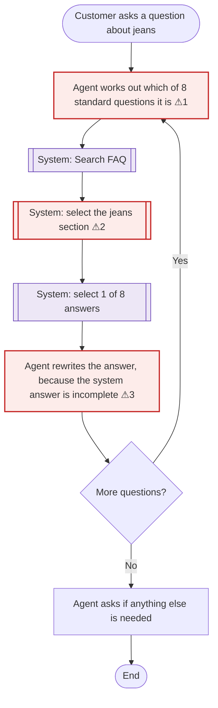
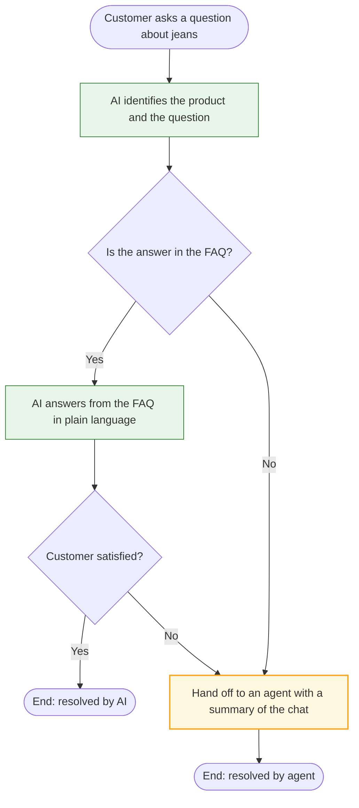
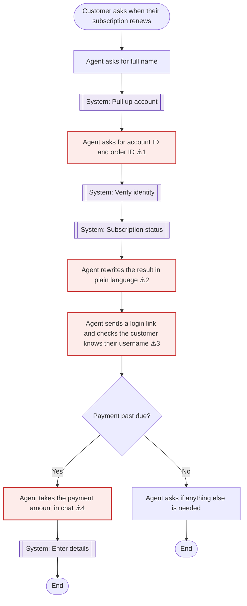
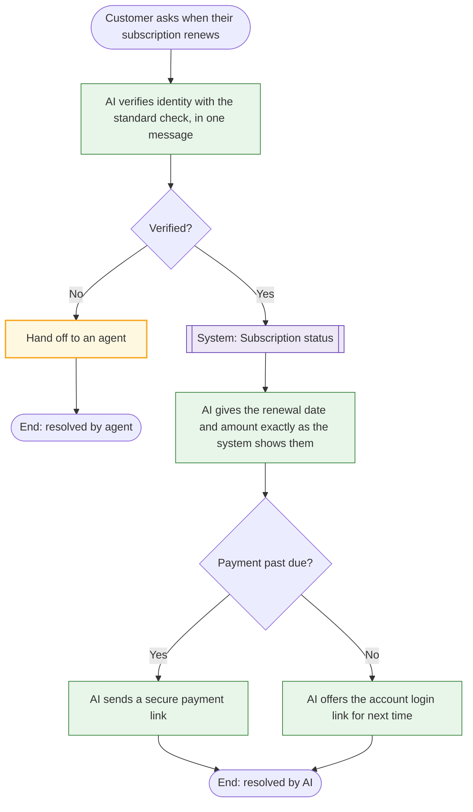
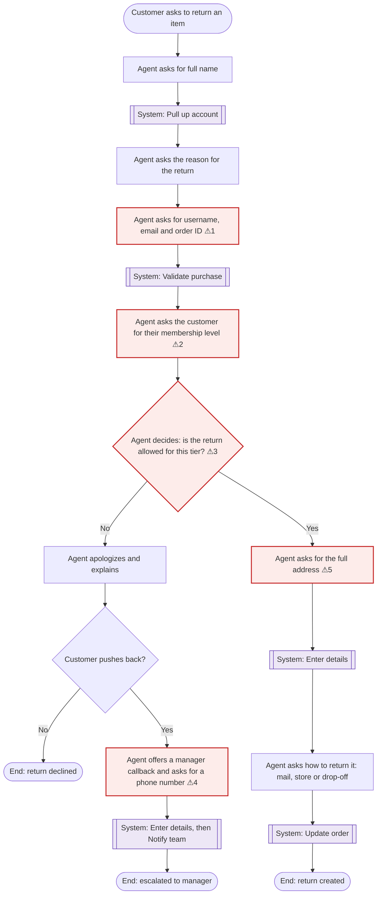
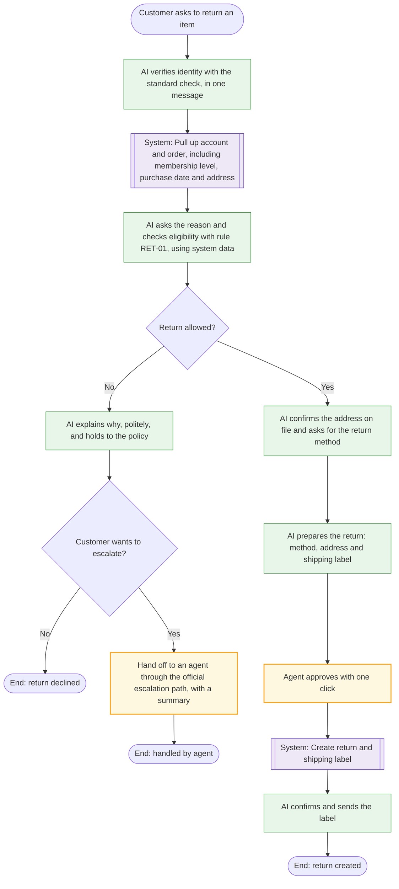

# Process Maps: Current Process and Future Process with AI

**Project:** AI Customer Support Assistant  |  **Step 5 of 11**  |  **Version:** 1.0 (draft)

**Sources:** agent guidelines and business rules (Step 3), conversation statistics (Step 2), the
automation tiers (Step 4), and conversation 3592 as a real example.

---

## 1. Processes mapped

One request type was chosen from each automation tier, so the maps show how the AI fits in at
each level of autonomy.

| Request type | What the customer wants | Tier | Conversations | Median length | Customer messages | System actions | Rules |
|---|---|---|---|---|---|---|---|
| `jeans` | An answer to a product question | A: AI handles alone | 252 | 15 turns | 5 | 3 | FAQ-01 |
| `status_due_date` | Their subscription renewal date | B: AI handles after verification | 178 | 24 turns | 9 | 5 | ID-02, SUB-01 |
| `return_size` | To return an item that doesn't fit | C: AI prepares, person approves | 191 | 29 turns (the longest of all 55) | 12 | 5 | ID-01, RET-01 to RET-04 |

### How to read the diagrams

| Shape and color | Meaning |
|---|---|
| Rounded box | Start or end |
| Plain box | A step done by the agent or the customer |
| Double-edged box (purple) | A system action |
| Diamond | A decision |
| **Red box, numbered ⚠** | A pain point, explained in the table under the diagram |
| Green box | A step done by the AI assistant |
| Amber box | A person approves or takes over |

---

## 2. Product question (`jeans`), tier A

### Current process

| # | Pain point | Evidence | Effect |
|---|---|---|---|
| ⚠1 | The agent has to interpret the question and match it to a list. | FAQ-01: every jeans question is one of 8 standard questions | Agent time spent on a task that's pure pattern matching |
| ⚠2 | Three separate system clicks to reach one answer. | 3 actions in a median conversation | Slows the agent down for every product question |
| ⚠3 | The stored answer is incomplete, so the agent rewrites it every time. | The guideline says the system response "does not include all the information" | Answers vary from agent to agent |

### Future process with AI

**What changes:** the agent isn't involved unless the question falls outside the FAQ or the
customer is still unhappy. The FAQ answers are also completed once, so every customer gets the
same full answer.

**Extra recommendation:** the 8 standard questions per product could also be shown on the
product page itself, so many customers never need to open a chat.

---

## 3. Subscription renewal date (`status_due_date`), tier B

### Current process

| # | Pain point | Evidence | Effect |
|---|---|---|---|
| ⚠1 | The customer needs an **order ID** to ask about their **subscription**. | ID-02 requires full name, account ID and order ID | Customers have to go and find an unrelated number. 9 customer messages for a one-line answer |
| ⚠2 | The agent translates the system result by hand, and the guideline even allows "adjusting" values that look wrong. | SUB-01, issue 1 | Risk of telling the customer the wrong date or amount |
| ⚠3 | The login link and username check are added to every chat, even when the customer didn't ask. | SUB-01 | Adds turns: a median of 24 for a date lookup |
| ⚠4 | Payment details are handled in the chat. | SUB-01, issue 2 | Payment security risk |

### Future process with AI

**What changes:** the customer is asked for identity information once instead of twice, and
doesn't need an order ID. The AI states only what the system returns. Payment moves to a secure
link, and no record is changed in the chat, which is why this request is tier B.

---

## 4. Return due to wrong size (`return_size`), tier C

### Current process

This map follows the guidelines and matches what happened in conversation 3592.

| # | Pain point | Evidence | Effect |
|---|---|---|---|
| ⚠1 | Identity is collected in two rounds: name first, then username, email and order ID. | GEN-01, ID-01 | The customer is asked for 4 pieces of information across separate messages |
| ⚠2 | The membership level comes from the customer, not the account. | RET-01, **issue 13 (new)** | A customer could say "Gold" to get unlimited returns |
| ⚠3 | The agent applies a four-tier eligibility rule from memory, including date, receipt and packaging options. | RET-01, membership table | Inconsistent decisions between agents |
| ⚠4 | The manager escalation isn't in the written policy. | RET-02, issue 10, conversation 3592 | The documented policy and real practice differ |
| ⚠5 | The customer is asked for their address, even though the account already has it. | RET-03 | An extra question, and a chance for typos on the shipping label |

**Overall:** this is the longest request type in the dataset (median 29 turns, 12 customer
messages). The customer is asked for information **6 separate times**: name, reason, identity
details, membership level, address and return method.

### Future process with AI

**What changes:** the customer is asked for information 3 times instead of 6 (identity, reason,
return method). The membership level, purchase date and address come from the system. The
eligibility rule is applied the same way every time. The agent's work shrinks from handling the
whole chat to one approval, and declined returns follow one official escalation path.

---

## 5. Summary

| | `jeans` (A) | `status_due_date` (B) | `return_size` (C) |
|---|---|---|---|
| Agent involvement today | Whole chat | Whole chat | Whole chat |
| Agent involvement with AI | Only on handoff | Only on handoff | One approval click, plus handoffs |
| Times the customer is asked for information, today → with AI | 0 → 0 | 2 → 1 | 6 → 3 |
| Pain points found | 3 | 4 | 5 |
| Policy issues these maps rely on (Step 3) | none | 1, 2 | 10, 13 |

**New finding:** mapping the returns process showed that the membership level is taken from the
customer instead of the system. This was added to the business rules catalog as **issue 13**, and
the automation matrix was updated to show it on the 14 request types that use the membership level.

---

## 6. Editing these diagrams

The diagrams are written in Mermaid, which GitHub draws automatically. To edit one, change its
text in this file. To get a version you can drag and drop, copy a diagram's text, open
[draw.io](https://app.diagrams.net), and choose **Arrange → Insert → Advanced → Mermaid**.

## 7. Next step

**Step 6:** turn the business rules, the automation tiers and these future processes into the
requirements document (BRD).
