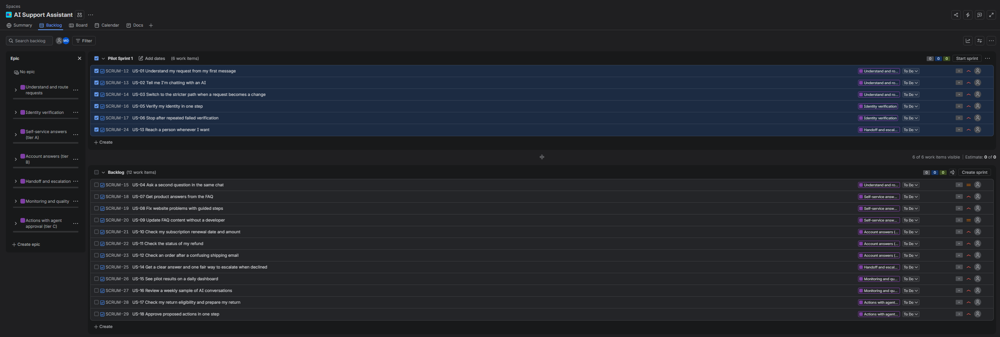

# User Stories and Acceptance Criteria

**Project:** AI Customer Support Assistant  |  **Step 7 of 11**  |  **Version:** 1.0 (draft)

**Source:** [Business Requirements Document](05_requirements_BRD.md). Every story lists the
requirements it delivers, so the chain runs: evidence → business rule → requirement → user story
→ test case (Step 8).

**Jira:** these stories are also in [`jira_import.csv`](jira_import.csv), ready to import.

*Jira backlog: the 7 epics are on the left. Pilot Sprint 1 holds the 6 foundation stories
(routing, AI disclosure, the stricter-path rule, identity verification and handoff), because
every other story depends on them.*

---

## 1. Backlog summary

**18 stories in 7 epics:** 16 for the pilot and 2 for Phase 2.

| Epic | Name | Phase | Stories |
|---|---|---|---|
| E1 | Understand and route requests | Pilot | US-01, US-02, US-03, US-04 |
| E2 | Identity verification | Pilot | US-05, US-06 |
| E3 | Self-service answers (tier A) | Pilot | US-07, US-08, US-09 |
| E4 | Account answers (tier B) | Pilot | US-10, US-11, US-12 |
| E5 | Handoff and escalation | Pilot | US-13, US-14 |
| E6 | Monitoring and quality | Pilot | US-15, US-16 |
| E7 | Actions with agent approval (tier C) | Phase 2 | US-17, US-18 |

**Priority** uses MoSCoW: Must, Should or Could have, for the phase shown.

## 2. Definition of Ready and Definition of Done

| A story is **ready** when... | A story is **done** when... |
|---|---|
| It has a user, a goal and a reason | All acceptance criteria pass in testing |
| Acceptance criteria are written in Given / When / Then | The linked test cases (Step 8) pass |
| It's linked to at least one BRD requirement | No card numbers, passwords or unmasked personal data appear in test transcripts |
| Any policy decision it depends on (BRD section 10) has been made | The product owner has accepted it |

---

## 3. Stories

### E1: Understand and route requests (Pilot)

*The assistant identifies what the customer needs and sends each request down the right path for its tier.*

#### US-01: Understand my request from my first message

> **As a** customer, **I want** the assistant to understand what I need from my first message, **so that** I don't have to click through menus or explain twice.

**Priority:** Must  |  **Phase:** Pilot  |  **Requirements:** FR-01, FR-02, FR-05, FR-26, FR-32  |  **Evidence:** Automation matrix (Step 4)

**Acceptance criteria:**

1. **Given** a message that matches one of the 55 request types, **when** the customer sends it, **then** the assistant identifies the request type and follows the path for its tier.
2. **Given** the request is unclear, **when** the assistant has asked two clarifying questions and still can't identify it, **then** it hands off to an agent with a summary.
3. **Given** a tier D request (for example, a password reset), **when** it's identified, **then** the assistant hands off right away and tells the customer an agent will help.
4. **Given** a situation that no written business rule covers, **when** the assistant reaches it, **then** it hands off instead of improvising.

#### US-02: Tell me I'm chatting with an AI

> **As a** Legal and Compliance lead, **I want** customers to be told at the start that they're chatting with an AI, **so that** we're open with customers and meet disclosure obligations.

**Priority:** Must  |  **Phase:** Pilot  |  **Requirements:** NFR-01, NFR-12  |  **Evidence:** Brief: Legal and Compliance

**Acceptance criteria:**

1. **Given** a new chat, **when** it opens, **then** the first message says the customer is talking to an AI assistant and can ask for a person at any time.
2. **Given** the chat window, **when** it's used with a screen reader or keyboard only, **then** all controls work (WCAG 2.1 AA).

#### US-03: Switch to the stricter path when a request becomes a change

> **As a** support team lead, **I want** a read-only request that turns into a change to move to the stricter path, **so that** the assistant never changes a record during the pilot.

**Priority:** Must  |  **Phase:** Pilot  |  **Requirements:** FR-03, NFR-06, CO-2  |  **Evidence:** Step 5: 10% of status_due_date chats end in a change

**Acceptance criteria:**

1. **Given** a verified customer asking about their subscription (tier B), **when** they ask to renew or change it, **then** the assistant doesn't change anything.
2. **Given** that situation in the pilot, **when** the change is requested, **then** the assistant hands off to an agent with a summary of the request.
3. **Given** any chat in the pilot, **when** the assistant runs, **then** it has read-only access to company systems.

#### US-04: Ask a second question in the same chat

> **As a** customer, **I want** to ask another question after my first one is answered, **so that** I can sort out everything in one chat.

**Priority:** Should  |  **Phase:** Pilot  |  **Requirements:** FR-04  |  **Evidence:** Step 5: 4% of jeans chats have two questions; GEN-02

**Acceptance criteria:**

1. **Given** a first request has been answered, **when** the customer asks a new question, **then** the assistant identifies the new request type and handles it under its own tier.
2. **Given** the customer is already verified, **when** the second request also needs verification, **then** the assistant doesn't ask again in the same chat.

### E2: Identity verification (Pilot)

*Customers verify their identity once, safely and consistently, before any account information is shared.*

#### US-05: Verify my identity in one step

> **As a** customer, **I want** to give my identity details once, in one message, **so that** I can get help quickly without repeating myself.

**Priority:** Must  |  **Phase:** Pilot  |  **Requirements:** FR-06, FR-07, FR-11  |  **Evidence:** ID-02; issues 4, 5, 13; Step 5 pain points

**Acceptance criteria:**

1. **Given** a request that needs the account, **when** verification starts, **then** the assistant asks for all the standard details in a single message.
2. **Given** a subscription question, **when** verification starts, **then** the customer isn't asked for an order ID.
3. **Given** verification succeeds, **when** the assistant continues, **then** it never asks for anything the system holds: membership level, shipping status, address or purchase date.

#### US-06: Stop after repeated failed verification

> **As a** IT Security lead, **I want** verification to stop after 3 failed attempts without saying which detail was wrong, **so that** nobody can guess their way into an account.

**Priority:** Must  |  **Phase:** Pilot  |  **Requirements:** FR-09, FR-10  |  **Evidence:** ID-06; issue 4

**Acceptance criteria:**

1. **Given** a customer fails verification 3 times, **when** the third attempt fails, **then** the assistant stops and hands off to an agent.
2. **Given** a failed attempt, **when** the assistant responds, **then** it doesn't say which detail was wrong.
3. **Given** any verification, **when** it runs, **then** a security question answer alone is never accepted.

### E3: Self-service answers (tier A) (Pilot)

*FAQ answers and guided website fixes, with no account access.*

#### US-07: Get product answers from the FAQ

> **As a** customer, **I want** quick, complete answers to product and store questions, **so that** I can decide what to buy without waiting for an agent.

**Priority:** Must  |  **Phase:** Pilot  |  **Requirements:** FR-12, FR-13, FR-14  |  **Evidence:** FAQ-01, FAQ-02; issue 1; Step 5: 23% of jeans chats skip the stored answer

**Acceptance criteria:**

1. **Given** a question covered by the FAQ (for example, 'Do these jeans shrink?'), **when** the customer asks, **then** the assistant answers from the FAQ in plain language.
2. **Given** a question not covered by the FAQ, **when** the customer asks, **then** the assistant says it doesn't have that answer and offers an agent. It doesn't guess.
3. **Given** an FAQ answer, **when** the assistant gives it, **then** it doesn't paste raw system text.

#### US-08: Fix website problems with guided steps

> **As a** customer having trouble with the website, **I want** step-by-step help to fix it, **so that** I can finish my purchase.

**Priority:** Must  |  **Phase:** Pilot  |  **Requirements:** FR-15, FR-16, NFR-03  |  **Evidence:** TRB-01 to TRB-03; issue 2

**Acceptance criteria:**

1. **Given** one of the 4 website problems, **when** the customer describes it, **then** the assistant offers the approved fixes one at a time.
2. **Given** a search or speed problem, **when** it's identified, **then** the assistant reports it to the Website Team.
3. **Given** none of the fixes work, **when** the customer still wants to buy, **then** the assistant offers a secure checkout link and never asks for card details.
4. **Given** a customer types a card number anyway, **when** the message arrives, **then** it's masked in the transcript and the assistant asks them not to share card details in chat.

#### US-09: Update FAQ content without a developer

> **As a** support operations specialist, **I want** to update FAQ answers myself, **so that** answers stay complete and current without waiting for a release.

**Priority:** Should  |  **Phase:** Pilot  |  **Requirements:** FR-17  |  **Evidence:** Step 5: stored FAQ answers are incomplete

**Acceptance criteria:**

1. **Given** an FAQ answer needs changing, **when** the specialist edits and publishes it, **then** the assistant uses the new answer in new chats.
2. **Given** an edit, **when** it's published, **then** the change is logged with who made it and when.

### E4: Account answers (tier B) (Pilot)

*Read-only account information after verification: subscription, refund and shipping status.*

#### US-10: Check my subscription renewal date and amount

> **As a** subscriber, **I want** to check when my subscription renews and how much is due, **so that** I can plan my payment.

**Priority:** Must  |  **Phase:** Pilot  |  **Requirements:** FR-18, FR-19, FR-20, FR-21  |  **Evidence:** SUB-01; issues 1, 2; Step 5: 23% of these chats took payment in chat

**Acceptance criteria:**

1. **Given** a verified customer, **when** they ask about their subscription, **then** the assistant gives the status, due date and amount exactly as the system shows them.
2. **Given** the payment is past due, **when** the assistant explains this, **then** it sends a secure payment link and doesn't take payment details in chat.
3. **Given** a value is missing or looks wrong (for example, due today but $0), **when** the assistant sees it, **then** it says so and hands off instead of adjusting it.

#### US-11: Check the status of my refund

> **As a** customer waiting for a refund, **I want** to see where my refund is, **so that** I know when to expect it.

**Priority:** Must  |  **Phase:** Pilot  |  **Requirements:** FR-18, FR-19, FR-33  |  **Evidence:** RET-08, RET-09; issue 1

**Acceptance criteria:**

1. **Given** a verified customer, **when** they ask about a refund, **then** the assistant gives the status (not started, in progress or complete) and how it was requested, from the system.
2. **Given** the system has no refund record, **when** the assistant checks, **then** it says so and offers an agent. It never picks a status.
3. **Given** the customer disagrees with the status, **when** they say so, **then** the assistant offers the official escalation path.

#### US-12: Check an order after a confusing shipping email

> **As a** customer who got a confusing shipping email, **I want** to check whether my order is still correct, **so that** I know whether I need to do anything.

**Priority:** Must  |  **Phase:** Pilot  |  **Requirements:** FR-18, FR-03  |  **Evidence:** SHP-01

**Acceptance criteria:**

1. **Given** a verified customer, **when** they ask about a shipping email, **then** the assistant checks the order in the system and explains what it shows.
2. **Given** the order is correct, **when** the assistant explains, **then** it tells the customer the email was wrong and nothing needs to change.
3. **Given** something needs fixing (date, address, item or price), **when** the assistant finds it, **then** it hands off with a summary, because fixes are changes (tier C).

### E5: Handoff and escalation (Pilot)

*Customers can always reach a person, and nobody has to repeat themselves.*

#### US-13: Reach a person whenever I want

> **As a** customer, **I want** to reach a person at any time without repeating myself, **so that** I'm never stuck with the AI.

**Priority:** Must  |  **Phase:** Pilot  |  **Requirements:** FR-30, FR-31, FR-35, FR-38  |  **Evidence:** Step 5: customers repeat information today

**Acceptance criteria:**

1. **Given** any point in the chat, **when** the customer asks for a person, **then** the assistant hands off right away.
2. **Given** a handoff, **when** the agent joins, **then** they see a summary (request type, verification status, what was tried, the customer's words) and the full transcript.
3. **Given** it's outside support hours, **when** a handoff is needed, **then** the assistant creates a ticket and tells the customer when to expect a reply.

#### US-14: Get a clear answer and one fair way to escalate when declined

> **As a** customer whose request is declined, **I want** a clear reason and one fair way to escalate, **so that** I understand the decision and know my options.

**Priority:** Must  |  **Phase:** Pilot  |  **Requirements:** FR-27, FR-33, FR-34, NFR-08, NFR-09  |  **Evidence:** RET-02; issue 10; conversation 3592

**Acceptance criteria:**

1. **Given** a request is declined, **when** the assistant explains, **then** it gives the reason from the business rule in plain language.
2. **Given** the customer pushes back (for example, 'What if I ask really nicely?'), **when** they repeat the request, **then** the outcome doesn't change and the assistant stays polite.
3. **Given** the customer wants to escalate, **when** they ask, **then** the assistant offers the official escalation path and confirms the phone number on file for a callback.

### E6: Monitoring and quality (Pilot)

*The business can see whether the pilot is working and catch mistakes early.*

#### US-15: See pilot results on a daily dashboard

> **As a** Head of Customer Experience, **I want** a daily dashboard of the pilot's success measures, **so that** I can decide whether to expand the pilot.

**Priority:** Must  |  **Phase:** Pilot  |  **Requirements:** FR-39, FR-40, FR-41  |  **Evidence:** BRD section 3

**Acceptance criteria:**

1. **Given** the pilot is running, **when** the dashboard opens, **then** it shows containment rate, correct handoff rate, policy compliance, wrong-answer rate, CSAT and sensitive-data incidents, updated daily.
2. **Given** any conversation, **when** it ends, **then** it's logged with request type, tier, outcome, handoff reason and actions.
3. **Given** a chat ends, **when** the customer is shown the survey, **then** it's one question.

#### US-16: Review a weekly sample of AI conversations

> **As a** support team lead, **I want** to review a sample of AI conversations every week, **so that** I catch wrong answers and policy mistakes early.

**Priority:** Must  |  **Phase:** Pilot  |  **Requirements:** FR-42, NFR-02, NFR-05  |  **Evidence:** OBJ-2

**Acceptance criteria:**

1. **Given** a week of AI conversations, **when** the review starts, **then** the team lead gets a random sample covering every request type in the pilot.
2. **Given** a reviewed conversation, **when** the lead marks it, **then** they can record whether it was correct and followed policy, and that feeds the dashboard.
3. **Given** a review, **when** the lead opens a transcript, **then** personal data is masked.

### E7: Actions with agent approval (tier C) (Phase 2)

*The assistant prepares refunds, returns and changes; an agent approves them.*

#### US-17: Check my return eligibility and prepare my return

> **As a** customer returning an item that doesn't fit, **I want** the assistant to check whether I can return it and prepare the return, **so that** I get an answer in one short chat.

**Priority:** Must  |  **Phase:** Phase 2  |  **Requirements:** FR-11, FR-22, FR-23, FR-24  |  **Evidence:** RET-01 to RET-04; issue 13; Step 5: 9% of returns skip the eligibility check

**Acceptance criteria:**

1. **Given** a verified customer, **when** they ask to return an item, **then** the assistant reads the membership level, purchase date and address from the system and doesn't ask for them.
2. **Given** the eligibility rule RET-01, **when** the assistant applies it, **then** these examples give these results: Gold, any date: allowed. Silver, 5 months, no receipt: allowed. Bronze, 120 days, no receipt, not in original packaging: declined. Guest, 20 days: allowed. Guest, 45 days, original packaging only: declined.
3. **Given** the return is allowed, **when** the customer chooses mail, store or drop-off, **then** the assistant prepares the return for agent approval and doesn't create it yet.
4. **Given** the return is declined, **when** the assistant explains, **then** it follows US-14.

#### US-18: Approve proposed actions in one step

> **As a** support agent, **I want** to approve, reject or edit what the assistant proposes in one step, **so that** I stay in control without redoing the whole chat.

**Priority:** Must  |  **Phase:** Phase 2  |  **Requirements:** FR-23, FR-24, FR-36, FR-37  |  **Evidence:** Step 5: future returns process

**Acceptance criteria:**

1. **Given** a proposed action, **when** the agent opens it, **then** they see the customer, the action, the amount, the rule applied and the data used.
2. **Given** the agent rejects it, **when** they confirm, **then** they must choose a reason code.
3. **Given** no agent has approved it, **when** the assistant would act, **then** nothing happens in any system.

---

## 4. Requirements coverage

Pilot requirements from the BRD and the stories that deliver them:

| Requirement group | Requirements | Stories |
|---|---|---|
| Understanding and routing | FR-01 to FR-05, FR-26 | US-01, US-03, US-04, US-12 |
| Identity verification | FR-06, FR-07, FR-09 to FR-11 | US-05, US-06, US-17 |
| Answers and troubleshooting | FR-12 to FR-17 | US-07, US-08, US-09 |
| Account information | FR-18 to FR-21 | US-10, US-11, US-12 |
| Handoff and escalation | FR-27, FR-30 to FR-35, FR-38 | US-13, US-14 |
| Monitoring | FR-39 to FR-42 | US-15, US-16 |
| Non-functional | NFR-01 to NFR-03, NFR-05, NFR-06, NFR-08, NFR-09, NFR-12 | US-02, US-03, US-08, US-14, US-16 |
| Phase 2 approvals | FR-08, FR-22 to FR-29, FR-36, FR-37 | US-17, US-18 (more stories to be written for Phase 2) |

Non-functional requirements not tied to a single story (NFR-04, NFR-07, NFR-10, NFR-11, NFR-13,
NFR-14) apply to every story and are checked in the test plan.

## 5. Next step

**Step 8:** turn the acceptance criteria into test cases, add tricky cases from real
conversations, and finalize the success measures.
